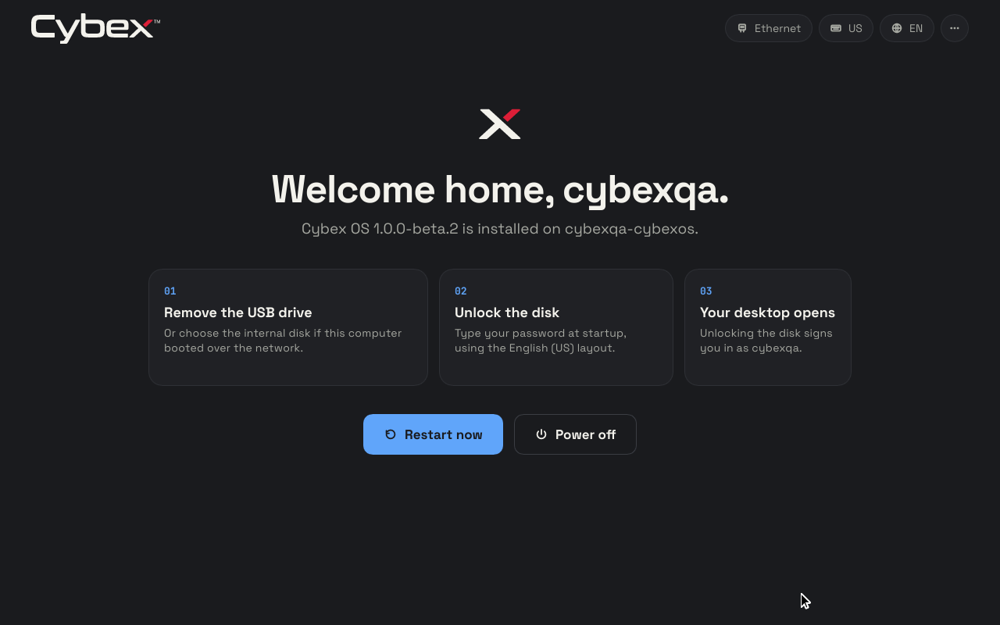

# Encrypted automatic login and firmware entry — 2026-10-25

Encrypted installations now sign the owner in when the disk unlocks: no SDDM
greeter appears and GNOME Keyring is unlocked from the same passphrase. The
firmware lists the installed boot loader as **CybexOS** rather than
"NixOS-boot". This follows the
[installed boot menu record](installed-boot-menu-2026-10-25.md) and its
[JSON evidence](encrypted-autologin-2026-10-25.json).

## Tested image

- Version `1.0.0-beta.2`, NixOS `26.05`, base commit
  `2baf92dcee4df6d00087be7ffa6e9d2fd6b670ba` plus these changes, revision
  `uncommitted`.
- Exact source NAR: `sha256-/SNyfcL/sDtTgEvh5Ad4xFHSh+Cqpy0L7CM7jJ9WaRA=`
  (1,280 files, frozen before building).
- ISO: `/data/pxe/iso/cybexos-1.0.0-beta.2-20261025-autologin.iso`,
  **7,113,609,216 bytes**, SHA-256
  `23b749d2ec0680a8c7e3aa78589a95ba8c1a879c9fe48661e5c988ca37f79657`,
  with its `.iso.sha256` beside it.

## What changed

- **Installer.** The graphical installer plans automatic login exactly when the
  disk is encrypted. The worker no longer rejects it, and the terminal
  installer defaults to it. The review reads "signs in after disk unlock"; the
  completion screen says **Your desktop opens**. A plain disk keeps password
  login.
- **Keyring handoff.** NixOS's `sddm-autologin` PAM stack has no default rules,
  so its `enableGnomeKeyring` flag had no effect: `pam_systemd_loadkey` loaded
  the cached disk passphrase, but nothing passed it to GNOME Keyring. The stack
  now adds `pam_gnome_keyring` after it. SDDM runs with `KeyringMode=shared`
  (as NixOS does for GDM), so it can read the key that `systemd-cryptsetup`
  cached in root's keyring.
- **Once per boot.** A requisite `pam_exec` step creates
  `/run/cybexos-autologin-used` as the last check before success. A restarted
  SDDM daemon therefore shows the password greeter instead of opening another
  desktop. The existing encryption verification still runs first.
- **Firmware entry.** GRUB installs to `EFI/CybexOS` with the firmware entry
  **CybexOS**. The GRUB menu entries keep reading **Cybex OS**.
- **Contract.** AGENTS.md and the login documentation replace "password-only
  first login" with encryption-gated automatic login after disk unlock.

## Checks exercised

| Check | Result |
| --- | --- |
| Source tests in the Nix sandbox | 587 and 21 passed |
| Installer screen (Rust) | 20 unit, 8 rendered interaction and 4 presentation tests passed |
| ISO/installed parity | Passed: firmware entry, keyring rule order, `KeyringMode`, once-per-boot guard |
| Image/source parity | Passed, 40 checks |
| `checks.boot` VM test | Passed; the booted firmware entry is `CybexOS` and none names NixOS |
| Encrypted installation through the real tty1 installer screen, lifecycle scenario | Passed all 11 milestones and 8 lifecycle checks; reviewed plan `autoLogin: true` |
| Plain JSON-plan installation, lifecycle scenario | Passed all 10 milestones and 8 lifecycle checks; password login unchanged |
| PXE delivery | Checksum verified in place; iVentoy refresh `success`, `running`, image listed |

On the encrypted installation, every boot that reached the desktop was checked
without typing anything into the screen:

- The session was opened by the `sddm-autologin` PAM service.
- The once-per-boot marker existed.
- The login keyring collection reported `Locked = false`.

That covers the first boot, both password-change reboots, the trial boots, the
unconfirmed-trial fallback and the rollback. After each password change the old
disk key was rejected, the desktop opened automatically with the new
passphrase, and a stored secret was read back from the unlocked keyring.

Time to `multi-user.target` in the boot VM test: GRUB 18.2 and 20.4 s,
systemd-boot 16.9 and 18.4 s.

## Limits

Only virtual OVMF/QEMU firmware was exercised. Physical firmware boot lists and
the keyring handoff on real hardware remain unqualified. `systemd-cryptsetup`
keeps the passphrase for 2.5 minutes; a boot that reaches SDDM later leaves the
keyring locked until it is unlocked by hand. The once-per-boot guard is
configured and asserted, but restarting the display manager was not exercised.
Secure Boot installations keep Lanzaboote and remain refused by the installer.

## Cleanup

All `agent-resource` leases for this round closed with no remaining
resources. The round's Nix outputs (test disk image, drivers, ISO build,
installer and check outputs) and its staging directory
`/data/tmp/cybexos-autologin-20261025` were removed. The earlier
`cybexos-1.0.0-beta.2-20261025-grub-theme.iso` testing image, superseded by
this one, stays in `/data/pxe/iso` until its removal is requested.
