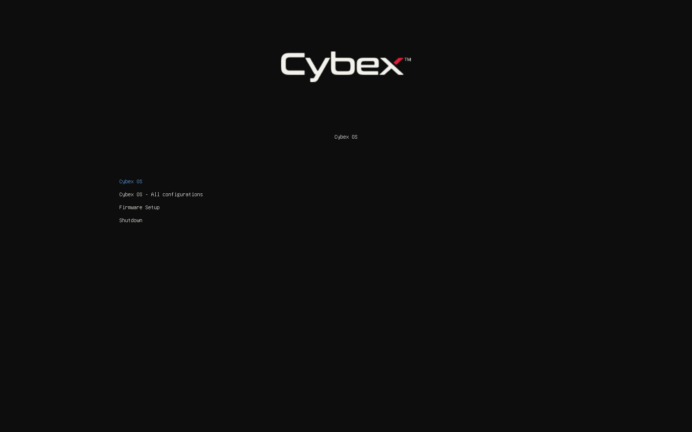
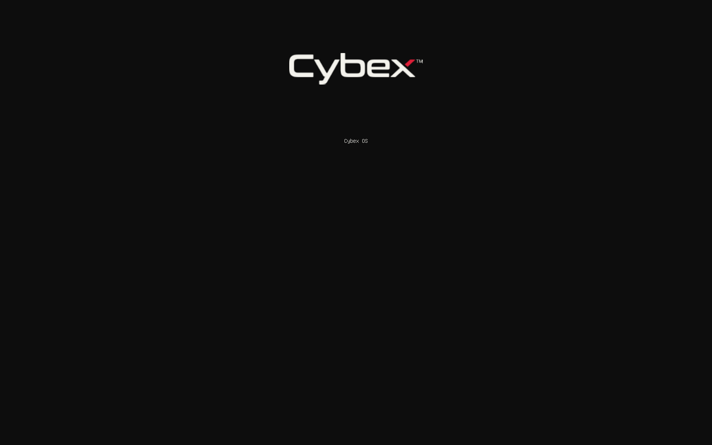
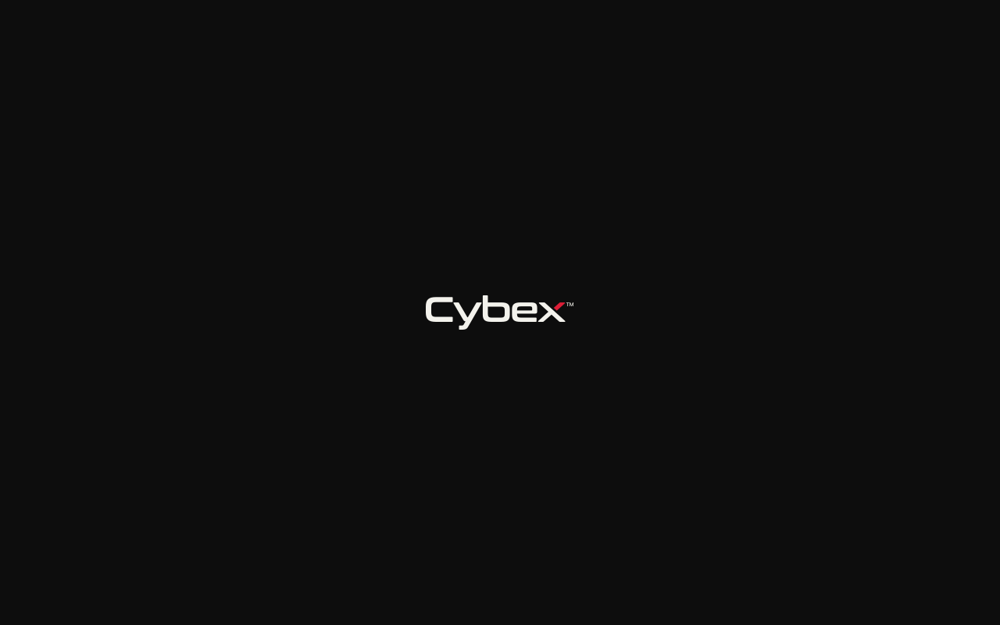

# Installed boot menu and quiet boot — 2026-10-25

Installed systems now boot GRUB with the installation medium's theme instead of
the plain systemd-boot menu, and boot quietly behind the Plymouth splash. Both
an encrypted and a plain installation from the final ISO passed installation,
boot, login and the full local updater lifecycle in disposable QEMU/KVM UEFI
guests on thebeast. The [JSON evidence](installed-boot-menu-2026-10-25.json)
records the exact source, image and individual results.

## Tested image

- Version: `1.0.0-beta.2`, NixOS `26.05`, x86_64.
- Base commit: `2baf92dcee4df6d00087be7ffa6e9d2fd6b670ba` plus these changes.
- Revision metadata: `uncommitted`; this is an unreleased working snapshot.
- Exact source NAR: `sha256-dhF6bsluur7qo81lMrNSQY2hIvkLP/9LEdvHO5e4CXA=`
  (1,275 files, frozen before building).
- ISO: `/data/pxe/iso/cybexos-1.0.0-beta.2-20261025-grub-theme.iso`,
  **7,113,609,216 bytes (6.63 GiB)**, with its `.iso.sha256` beside it.
- SHA-256: `6b24af7f36fe8b1273dda242e116a0ca7d47b2d0141fac1aa054b8e27b4afb20`.

This report, its JSON evidence and the three captures were written after the
source was frozen and are not part of that snapshot.

## What changed

- **Menu.** GRUB (EFI, `nodev`) uses the theme package shared with the ISO:
  the same `theme.txt`, logo, Unifont and mode list. Entries read **Cybex OS**,
  **Cybex OS - All configurations**, **Firmware Setup** and **Shutdown**, which
  replaces systemd-boot's "Reboot Into Firmware Interface". GRUB is also copied
  to the removable fallback path, as `bootctl install` did.
- **Exact boot selection.** `cybexos-boot-menu` labels each generation entry
  with an identifier derived from its exact system when the boot loader is
  installed. `cybexos-boot-trial` keeps the persistent default (`saved_entry`)
  and one-shot trial (`next_entry`) in `/boot/grub/grubenv`, written
  atomically. GRUB's own last-booted memory is not used. Secure Boot keeps
  Lanzaboote with the existing `bootctl` selection.
- **Quiet boot.** `quiet` and `udev.log_level=3` precede NixOS's `loglevel=3`
  (`boot.consoleLogLevel = 3`, `boot.initrd.verbose = false`). The kernel,
  EFI stub and systemd print nothing routine; Plymouth keeps unit status in
  its boot log behind the splash.
- **Loading screen.** GRUB clears its text window while it loads the 1.46 GB
  initrd. That window was a black box over 70% of the screen, on the ISO
  as well. The shared theme now places it over the menu entries and fills it
  with the theme colour, so the logo and label stay in place.

## Checks exercised

| Check | Result |
| --- | --- |
| Source tests in the Nix sandbox (`checks.lifecycle`) | 587 and 21 passed, including 14 new boot tests |
| ISO/installed parity (`checks.parity`) | Passed: same theme on both menus, quiet parameters, Secure Boot still selects Lanzaboote |
| Image/source parity (`scripts/check-image-parity`) | Passed, 40 checks, including `cybexos-boot-menu` |
| ISO EFI menu syntax | `grub-script-check` passed |
| `checks.boot` VM test | Passed, see below |
| Plain installation, lifecycle scenario | Passed all 10 milestones and 8 lifecycle checks |
| Encrypted installation, lifecycle scenario | Passed all 10 milestones and 8 lifecycle checks |
| PXE delivery | Checksum verified in place; iVentoy refresh `success`, `running`, image listed |

`checks.boot` installs a disk through `installBootLoader` inside `nixos-enter`,
as `nixos-install` does, onto a 16 GiB FAT32 ESP. It then boots real GRUB in
OVMF. With real system profiles and the updater's own selection command it
verified the following across real reboots:

- The labelled menu, theme files, fallback loader and firmware boot entry.
- A pinned generation outranking a newer one, including a nested
  specialisation submenu.
- A trial booting exactly once, then GRUB clearing `next_entry` and the next
  boot returning to the previous default.
- Commit and disarm.

The test keeps the instrumentation's console level and serial console off the
screen. The captured boot shows the menu, the logo while loading, the Plymouth
splash and the login screen, with no text.

The installation harness gained boot checks for real installs:

- The installed menu and theme, fallback loader, quiet kernel command line
  and console level 3.
- The GRUB selection after every apply, trial boot and confirmation.
- A new **unconfirmed trial fallback** scenario: an applied trial boots once;
  without confirmation the next boot returns to the previous generation and
  recovery restores it.
- Kernel and EFI stub text on the serial console: none in either case.

QA installations keep a serial console, so Plymouth uses its text view there
and shows unit status (151 and 156 lines). That is Plymouth's documented
serial behaviour, not what a screen without a serial console shows.

## Boot time

Seconds from VM start to `multi-user.target` in the same guest, both with the
five-second menu and the same 1.46 GB initrd: GRUB 18.7 and 21.3, systemd-boot
18.2 and 17.8. GRUB was about 2 s slower in this VM. In a 4 GiB guest
systemd-boot's EFI stub could not load this initrd at all ("Out of Resources")
and the firmware fell back to GRUB, which booted it.

## Earlier attempts

The first frozen snapshot passed its boot VM test. Its installations passed
everything up to the harness's first quiet-boot check, which then stopped them
before the lifecycle phase. That check counted Plymouth's serial-console unit
status as noise; it now fails only on kernel or EFI stub text. Its captures
also exposed the black loading box. Both were fixed, and every check above was
rerun from the second snapshot. The first images were removed.

## Limits

Only virtual OVMF/QEMU firmware was exercised. Physical firmware boot entries,
GRUB load times on real disks and Plymouth on real GPUs remain unqualified.
Secure Boot still uses Lanzaboote/systemd-boot without this theme and remains
unqualified; the installer continues to refuse Secure Boot installation. No
signed release or channel update was produced. The host was not changed or
rebooted, and no disk outside disposable guests was touched.

## Cleanup

All nine `agent-resource` leases closed with no remaining resources. The task's
Nix outputs were deleted, freeing 122.5 GB: five 21 GiB test disk images,
their drivers and two ISO builds. The frozen sources, logs and other captures
under `/data/tmp/cybexos-grub-theme-20261025` were removed. Retained: the
testing ISO and checksum in `/data/pxe/iso`, this report, its JSON evidence
and the three captures above (about 60 KB).
