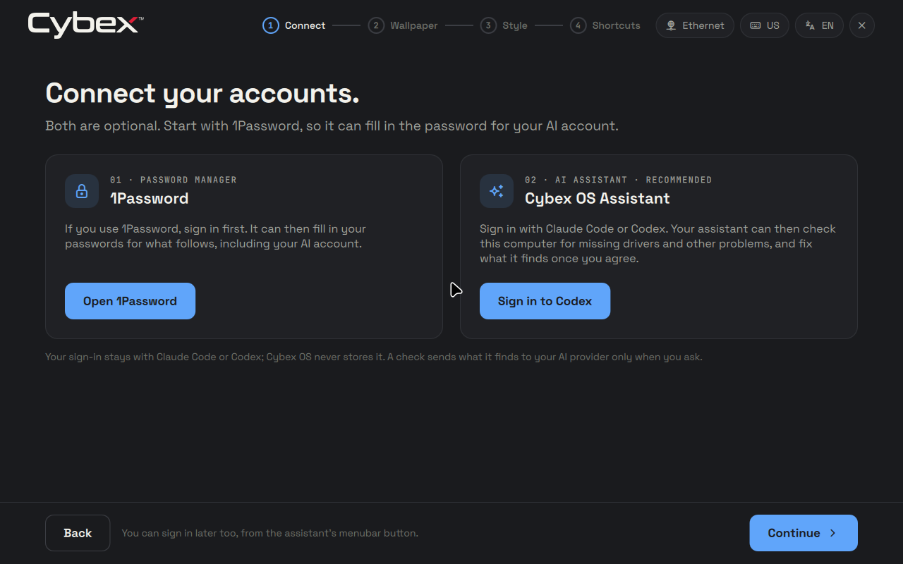
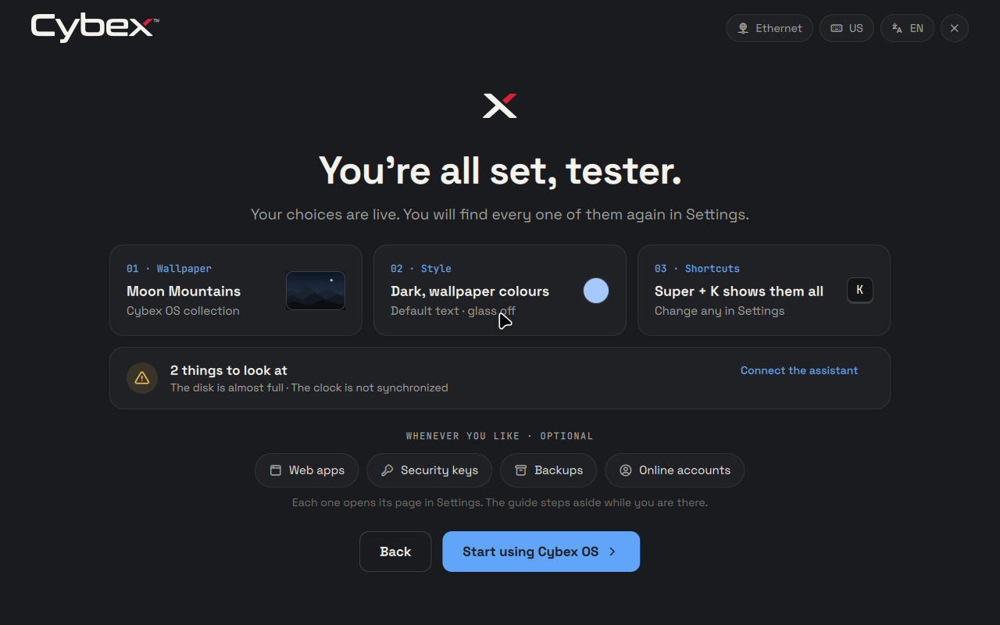

# Beta.13: Connect, the system check and the Assistant drag — 2026-10-28

The welcome guide gains a Connect step after Hello: 1Password first, when it
is installed, then the assistant's own Claude Code or Codex sign-in. A new
read-only `cybex doctor` checks the computer while the guide runs; Ready
reports it and hands it to the assistant on request. The Assistant character
could not be dragged on Hyprland; that is fixed.

## Changes

- `4d04408`: the Assistant's drag. Starting a drag hid the box, which switched
  the overlay's keyboard mode from OnDemand to None mid-press. Hovering had
  given that layer keyboard focus, so Hyprland 0.56.2 refocused the last window
  (`LayerSurface.cpp:389-394`), which releases every held button
  (`refocusLastWindow` → `releaseAllMouseButtons()`, `InputManager.cpp:1772`).
  The drag ended after one step. On an empty workspace Hyprland also keeps a
  held pointer on a surface only while some surface has keyboard focus
  (`InputManager.cpp:410-413`); otherwise each motion is hit-tested against
  the 64 px input region, and a quick drag became a click. The keyboard mode
  now follows the open box rather than its drawing, and the whole output takes
  the pointer while a button is held on the character.
- `83c231b`, `ab885d6`: the Connect step, Ready's system-check card, the
  Assistant's "Check this computer" (first suggestion in its box, Settings →
  Assistant, `cybexos-runtime ipc assistant check`), Dutch text and docs.
- `254ce11`…`c9b28e1`: `cybex doctor [--json]` ([system check](../system-check.md)),
  the assistant policy and per-turn system-check note, the `cybexos` skill's
  system-check reference. `cybex report --json` and other helper commands
  starting with an option are no longer rejected by the CLI.
- `1e649a8`, `5b8c694`: `checks.x86_64-linux.hyprland-pointer`, a NixOS VM test
  that boots the desktop into a real Hyprland session and drives it with
  QEMU's USB tablet; the welcome IPC gains `connect(item)` for it.
- `0915ed4`: `VERSION` advances to beta.13.

## Evidence before the image

- The Hyprland VM test reproduced the report on the unchanged shell and passes
  with the fix. Positions are the character's top-left on a 1280×800 output:

  | Scenario | Before the fix (moved) | With the fix (moved) |
  | --- | --- | --- |
  | Hover 600 ms, then drag in 20 steps, empty workspace | −15, +11 (one step) | −300, +220 |
  | Press at once, 20 steps, empty workspace | 260, −180 | 260, −180 |
  | Hover, then drag, beside a focused window | −11, +10 (one step) | −220, +200 |
  | Press at once, beside a focused window | 280, −200 | 280, −200 |
  | Four 70 px steps, empty workspace | 0, 0 (a click) | −200, +200 |

  A click still opens the box, a desktop click closes it, and a window then
  receives clicks and focus, before and after the fix. On the final source the
  same session also ran the Connect step against a stand-in 1Password window
  (a terminal of class `1Password`): Hyprland's openwindow event stepped the
  guide aside, another window closing left it aside, and closing the stand-in
  brought it back. The real `cybex doctor --json` returned all eleven checks in
  order; Ready reported them. No Assistant QML errors were logged.

  
  

  The VM's 4 GiB disk and missing network time make storage a problem and the
  clock a suggestion, which is correct for that VM.
- `tests/welcome-guide.py` drove the real shell and the real assistant service
  with a scripted Claude Code under headless Sway: 1Password from its desktop
  entry, the agent's own login command in a terminal and the guide's return
  once signed in, and Ask the assistant reaching the agent behind the
  system-check note. `tests/assistant-overlay.py` passes again: a fresh HOME
  had opened the full-screen guide over the character, failing every drag on
  `main`.
- `tests/run` passed on `0915ed4`, as did the `lifecycle` flake check built
  from it. Nothing ran on physical hardware.

## Artifact and source

- Served image: `/data/pxe/iso/cybexos-1.0.0-beta.13.iso` (7,120,576,512 bytes).
- Download: <http://10.10.0.7:16000/iso/cybexos-1.0.0-beta.13.iso>.
- Checksum: <http://10.10.0.7:16000/iso/cybexos-1.0.0-beta.13.iso.sha256> (92 bytes).
- SHA-256: `fd0b9c3101feb6a491e386ccb8fd9fc8ebc937bcc7746e78382a7edbeb6b558e`.
- Exact build revision: `0915ed4c1f7a04e24337330c2e1ecd9515103407`.
- Source NAR: `sha256-4ELu9W8vv61dp1JXNLdmsPsSLd5P57j8TVJ9+njJBC8=`.
- Version/platform: 1.0.0-beta.13, NixOS 26.05, x86_64-linux.

The ISO built from the exact committed Git flake and passed
`scripts/check-image-parity` in 41 sections against that revision and NAR. The
lock file was unchanged. This record is a later documentation-only commit; no
signed release or channel publication was performed.

## Installation qualification

`scripts/qualify-installations --case both --scenario lifecycle --interactive
--applications standard` installed the final ISO through the real tty1
installer screen, with keyboard and pointer input, onto blank disposable UEFI
disks, once plain and once encrypted. Both passed all 15 installation
milestones, among them ISO and installed source identity, quiet boot, the
installed boot menu, runtime encryption, the desktop configuration check, the
welcome guide at first login, keyboard shortcuts, authenticated desktop health
and password changes, and all 9 lifecycle checks: automatic preparation, an
upstream update with the vendor unavailable, personal baseline, evaluation and
build failures, interrupted-stage recovery, unconfirmed-trial fallback, local
apply with trial boot and confirmation, and rollback with personal persistence.
The installed Hello lists Connect first.

Not exercised: a real 1Password account or browser extension, a real Claude
Code or Codex sign-in, the assistant's system-check reply from a real model,
the Connect and Ready steps on an installed image (they ran on the same module
in the Hyprland VM), physical pointer devices, multi-display drags, NVIDIA,
physical sound and batteries, Secure Boot, physical PXE boot and signed-channel
updating.

## PXE delivery and cleanup

The image and its SHA-256 sidecar were copied and verified outside the served
tree, then moved in without overwriting, with mode 0644. The served checksum and
a full HTTP download matched. iVentoy's refresh returned success, its status
stayed running, the image tree listed beta.13 with every earlier image, and
`iventoy.service` remained active. The twelve existing files kept their inodes,
sizes and modification times. No service restart was needed.

The qualification lease `a906f97b89b04773b0a84a3d49a751da` and the VM test
leases closed with nothing remaining. Task staging under `/data/tmp`
(qualification disks, screenshots, logs and VM test outputs) was removed after
this record. The final image output
`/nix/store/38fygc287bl2l2naf59zlszi2mfwn8p3-cybexos-1.0.0-beta.13-x86_64-linux.iso`
and successful check outputs remain in the Nix-managed build cache.
