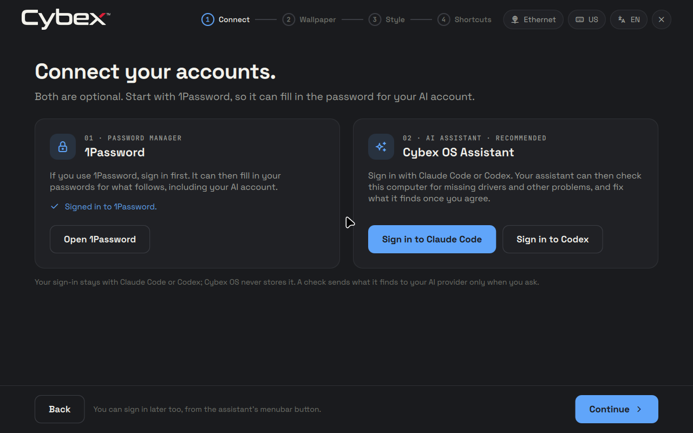

# Beta.14: 1Password in Brave and the Connect step's tick — 2026-10-28

On beta.13 the 1Password extension in Brave could not reach the signed-in
1Password app; it asked for a sign-in of its own. That is fixed. The welcome
guide's 1Password card now shows a tick once 1Password has an account.

## Changes

- `2c8b0be`: the browser link. Cybex OS ships Brave Origin, whose profile is
  `~/.config/BraveSoftware/Brave-Origin`. It looks for native messaging hosts
  only there and in `/etc/chromium/native-messaging-hosts` (seen with strace).
  1Password 8.12.21 writes its host, `com.1password.1password.json`, only to
  the profiles it knows: Chrome, Chromium, Edge, regular Brave
  (`Brave-Browser`), Vivaldi and Firefox. Cybex OS now installs the same entry
  in Chromium's system directory, pointing at the NixOS module's setgid
  `/run/wrappers/bin/1Password-BrowserSupport`. 1Password's own browser check
  already accepts the Origin executable, so no custom browser list is needed.
- `9e57ee2`: the tick. `scripts/onepassword-accounts.py` opens 1Password's
  database read-only and counts the rows of its `accounts` table, as
  1Password itself does; it reads no row. The guide asks when it opens or
  resumes, when Connect is shown, and every 4 s while Connect shows after
  1Password was opened. A database it cannot read leaves the card without a
  tick.
- `e47e9ca`: `VERSION` advances to beta.14.

## Evidence before the image

- New `checks.x86_64-linux.browser-1password` passes (about a minute). It
  boots the desktop with the proprietary applications into Hyprland, and
  1Password, not signed in, opens from the guide's Connect step. Brave Origin
  starts a probe carrying 1Password's public extension key, which gives it
  1Password's extension id. 1Password's helper ran as group `onepassword`,
  logged that it verified
  `…/brave-origin-1.97.59/opt/brave.com/brave/brave` and connected to the
  desktop app, and the app logged the extension connecting. The system entry
  matches the one this 1Password wrote for regular Brave. Against this
  1Password's real database the card had no tick. With 1Password stopped, an
  account row was added and the card showed its tick:

  

  Without the system entry the check fails. Run on the development host
  with no entry, Origin reported "Specified native messaging host not found"
  to the same probe.
- Once, as a development diagnostic, the Chrome Web Store extension 8.12.42.36
  was loaded unpacked in Origin in the same VM. It logged "Connected to the
  1Password 8 desktop app".
- `tests/welcome-guide.py` (real shell, headless Sway) adds an account to a
  database shaped like 1Password's while Connect shows; the card gets its
  tick. Unit tests cover the helper: no database, signed out, signed in, a
  damaged file and a database without the table. They also confirm the
  database and its write-ahead log are unchanged while a writer holds them.
- `tests/run` (699 Python and 1466 Node tests), `tests/qml-lint`,
  `checks.x86_64-linux.hyprland-pointer` and the `lifecycle` flake check
  passed on this source. Nothing ran on physical hardware.

## Artifact and source

- Served image: `/data/pxe/iso/cybexos-1.0.0-beta.14.iso` (7,120,576,512 bytes).
- Download: <http://10.10.0.7:16000/iso/cybexos-1.0.0-beta.14.iso>.
- Checksum: <http://10.10.0.7:16000/iso/cybexos-1.0.0-beta.14.iso.sha256> (92 bytes).
- SHA-256: `3eeb20ec7508c6d7d465f32cfe3e07d6d51a98d420e9ec8962f4c1bfa7d67248`.
- Exact build revision: `e47e9ca12e651e1343f24282f7200aa3ec8879a4`.
- Source NAR: `sha256-xuhzYE9g9/9cRWQ1Y+tpJ24d3n2gwtTaw0cLei4fHJE=`.
- Version/platform: 1.0.0-beta.14, NixOS 26.05, x86_64-linux.

The ISO built from the exact committed Git flake and passed
`scripts/check-image-parity` in 41 sections against that revision and NAR. The
lock file was unchanged. This record is a later documentation-only commit; no
signed release or channel publication was performed.

## Installation qualification

`scripts/qualify-installations --case both --scenario lifecycle --interactive
--applications standard` installed the final ISO through the real tty1
installer screen onto blank disposable UEFI disks, once plain and once
encrypted. Both passed all 16 installation milestones and all 9 lifecycle
checks, 50 results in all.

The milestones covered ISO and installed source identity, the prebuilt store
transfer, quiet boot, the installed boot menu, runtime encryption, the
desktop configuration check, native GUI assertions, the welcome guide at
first login, keyboard shortcuts, authenticated desktop health and password
changes.

The lifecycle checks covered automatic preparation, an upstream update with
the vendor unavailable, personal baseline, evaluation and build failures,
interrupted-stage recovery, unconfirmed-trial fallback, local apply with
trial boot and confirmation, and rollback with personal persistence.

Not exercised:
- a real 1Password account, and so the tick after a real sign-in;
- the store extension through Brave's own installation, and autofill;
- 1Password's window, tray and quit-on-close behaviour (its window does not
  draw in the VM);
- 1Password's "Start at login", which the session cannot honour because it
  does not run XDG autostart entries;
- a real Claude Code or Codex sign-in;
- physical hardware, Secure Boot, physical PXE boot and signed-channel
  updating.

## PXE delivery and cleanup

The image and its SHA-256 sidecar were copied and verified outside the served
tree, then moved in without overwriting, with mode 0644. The served checksum and
a full HTTP download matched. iVentoy's refresh returned success, its status
returned to running, and the image tree listed beta.14.

At the owner's request the earlier testing images, beta.7 to beta.13, and
their checksum files (14 files) were then removed. A second refresh returned
success, and the image tree lists only `cybexos-1.0.0-beta.14.iso`.
`iventoy.service` stayed active, and no restart was needed.

The qualification lease `ee7eecff12ce499e8543c39e40778f13` and the VM test
leases closed with nothing remaining. Task staging under `/data/tmp`
(qualification disks, screenshots, logs and VM test outputs) was removed after
this record. The final image output
`/nix/store/rnj68yqcbki30lxi9p47z8dmcxpqz84x-cybexos-1.0.0-beta.14-x86_64-linux.iso`
and successful check outputs remain in the Nix-managed build cache.
