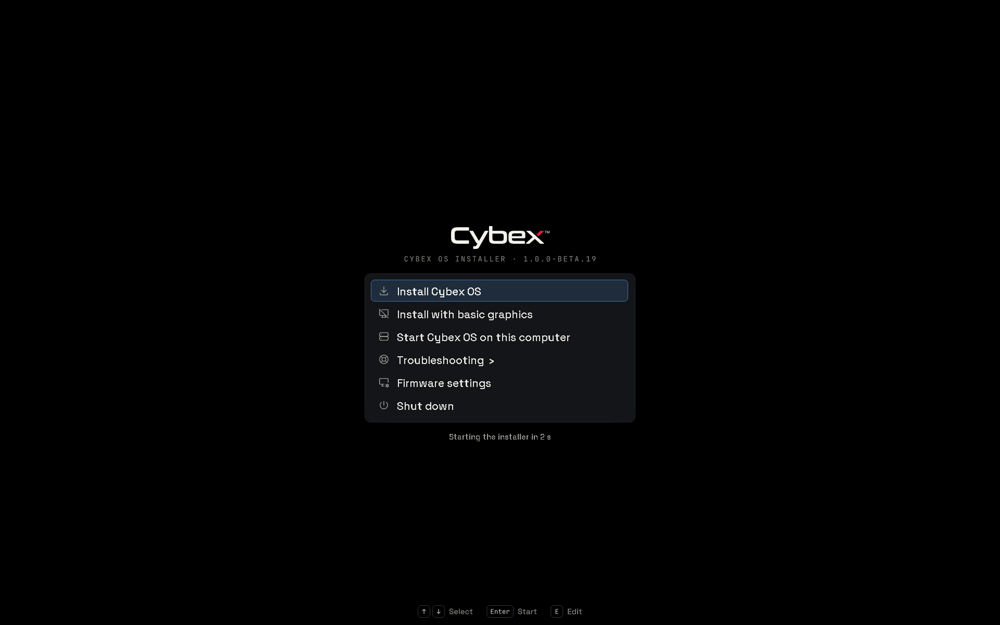
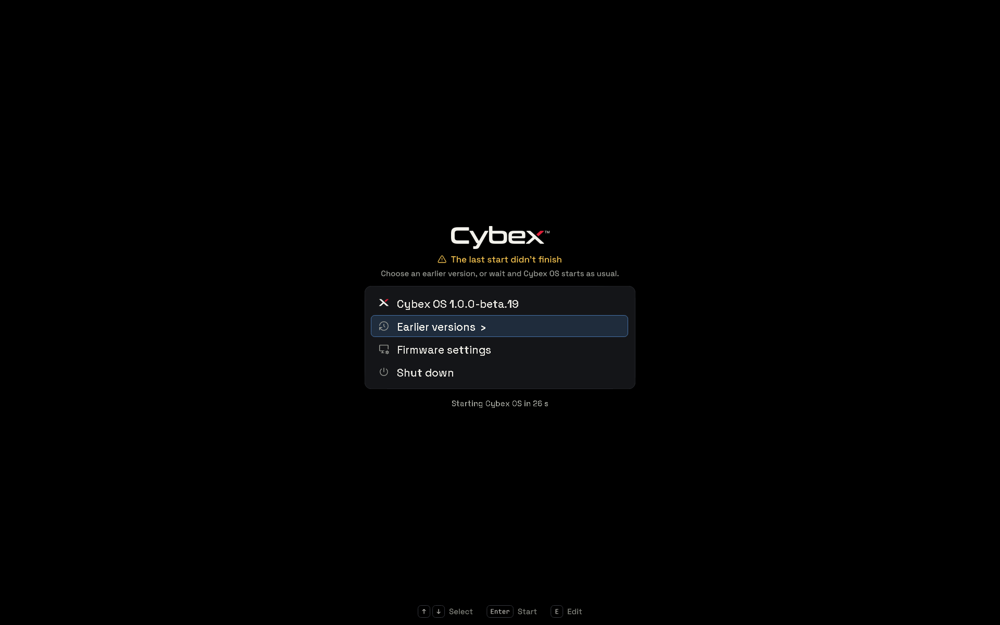
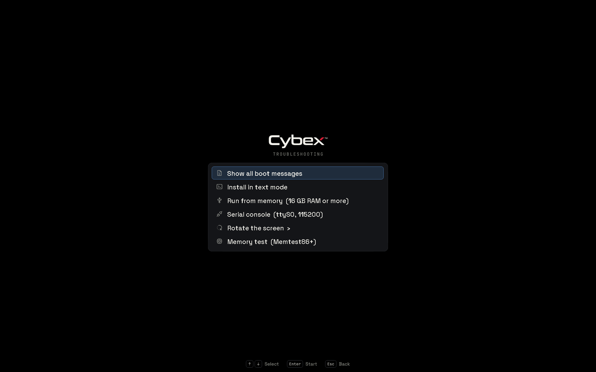
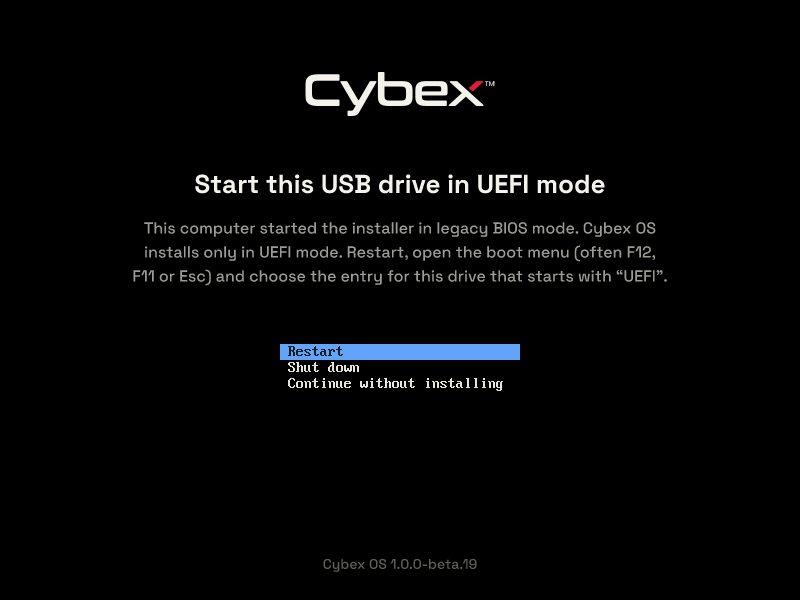

# Testing ISO beta.19: boot menus — 2026-10-29

The installation medium and installed systems share a new GRUB theme. The ISO
menu was restructured, and the installed menu is hidden unless it is needed.

## Exact source and image

- Version: `1.0.0-beta.19`.
- Base commit: `8699e4a5a689dda0be2b133786d9e1adff1b22af` plus these changes
  (revision metadata `uncommitted`).
- Source NAR: `sha256-ogxc9tGgyEGiWlBGGQhk7jobcnzWi3x33Pzgb0F/C8o=`, frozen
  before building; the ISO was built from that store copy of the source.
- ISO SHA-256: `0a1aeb0d44d9589e329c3b2f0c09aeb2224b83cfb40430ad82af17dfa551b15e`.
- ISO size: 7,120,576,512 bytes (6.632 GiB).
- Served ISO: `/data/pxe/iso/cybexos-1.0.0-beta.19.iso` with its `.iso.sha256`.

This record and its captures were written after the source was frozen and are
not part of that snapshot.

## What changed

- **Theme.** `desktop/boot/theme.py` builds the theme at Nix build time: the
  wordmark at 38% height, a card of Space Grotesk entries (GRUB 1-bit PF2
  fonts), Tabler 3.48.0 icons, a tinted selection, a countdown, and
  pre-rendered eyebrows, key hints and notices. Each list has row variants
  because GRUB sizes a list from its theme. Plymouth's logo moved from 50% to
  the same 38% anchor. The boot colour is black: GRUB's plain terminal, which a
  hidden menu leaves on screen while the initrd loads, can draw no other
  background.
- **ISO menu.** Install Cybex OS, Install with basic graphics, Start Cybex OS on
  this computer (only when partition 1 of a disk holds an installed Cybex OS
  loader), Troubleshooting ›, Firmware settings and Shut down. Troubleshooting
  holds all boot messages, text mode, run from memory, serial console, rotate
  the screen › and Memtest86+. The upstream Options tree, rEFInd and the
  display-manager quirk are gone. Rotation now also turns the graphical
  installer (`cybexos.rotate` → `SLINT_KMS_ROTATION`).
- **Legacy BIOS.** isolinux shows how to start the drive in UEFI mode, with
  restart, shut down and continue without installing.
- **Installed menu.** Hidden for one second (Esc opens it). `cybexos-boot-menu`
  titles generations with their Cybex OS version and time, names the submenu
  Earlier versions, picks icons and theme variants. GRUB marks each Linux start
  pending; `cybexos-boot-started.service` clears the mark after
  `multi-user.target`. A mark left by an unfinished start opens the menu with
  a notice and a 30 s countdown. Secure Boot keeps systemd-boot, now hidden.

## GRUB 2.12 findings

- Theme PNGs must be 8-bit RGBA; resvg writes them.
- A selection pixmap's padding is drawn outside `item_height`; unselected rows
  need a transparent item pixmap with the same padding or their text sits higher.
- `grub_gfxmenu_view_draw` scales `desktop-image` without checking for one. With
  only `desktop-color`, entering a submenu printed `null src bitmap` and waited
  for a key; the theme now ships an 8×8 background image. The previous theme's
  Options submenu had the same fault.
- The scrollbar needs `scrollbar_thumb_overlay`, or its padding exceeds a thin
  `scrollbar_width` and GRUB omits it.
- `search` prints `no such device` when nothing matches, so the medium probes
  `(hdN,gpt1)` with `[ -f ]`, which prints nothing.
- The EFI `chainloader` passes the loaded image `$root`, not the file's device.
  Without `set root=` first, the installed loader looked for its ESP on the USB
  medium and stopped at `grub rescue>`.
- A 3 px `progress_bar` drew 28 px tall; the countdown is text only.
- Firmware that does not connect a disk (OVMF without a boot index) hides the
  installed-system entry; the menu degrades to its five-entry variant.

## Build and static verification

The frozen source passed:

- `nix build SOURCE#iso` from the store copy of the source.
- `tests/run`: 744 Python and 1,511 Node cases (16 skipped), and `qml-lint`
  over 447 files.
- The installer package's 33 Rust tests (21 unit, eight interaction, four
  presentation), including the new rotation case.
- `checks.x86_64-linux.lifecycle`: 744 Python unit cases and 25
  system-settings cases.
- `checks.x86_64-linux.parity`, the shared installation contract, including
  the hidden menu, pending mark, start service and the Secure Boot timeout.
- All 42 completed-image/source parity checks.

## Boot menu verification

`checks.x86_64-linux.boot` passed all seven subtests: the installed theme and
exact-system titles, a quiet boot, a persistent selection, a one-time trial,
a start that did not finish, commit, and loading time. GRUB started in 14.0
and 14.7 seconds against 15.0 and 12.6 for systemd-boot. With the menu hidden,
every frame before Plymouth was uniformly black. An unfinished start opened the
menu with its notice; the countdown then started the pinned default and
`cybexos-boot-started.service` cleared the mark.

The built ISO then ran in disposable QEMU guests:

- **UEFI, beside an installed disk.** OVMF with the ISO as a USB stick and an
  overlay of the boot test's installed image. The menu showed all six entries.
  Start Cybex OS on this computer loaded the installed GRUB, which started the
  installed kernel and mounted its root partition. That image keeps its store
  on a 9p share only the test driver provides, so its boot ended there.
- **UEFI, the ISO alone.** The five-entry menu, Troubleshooting and Rotate the
  screen rendered without GRUB messages. Rotate clockwise started the graphical
  installer turned 90°.
- **Legacy BIOS.** SeaBIOS showed the UEFI notice with the beta.19 version.

## Installation and staged-updater verification

`scripts/qualify-installations ISO --case both --scenario lifecycle
--interactive` ran from 16:25 to 17:17.

- **plain-install: passed.** Real tty1 Slint installation with the full default
  application selection; 170 seconds in the installer worker (183.084 seconds
  observed by the harness).
- **encrypted-install: passed.** Real tty1 Slint installation with the full
  default application selection; 171 seconds in the installer worker (182.938
  seconds observed by the harness).

Both cases passed installed source identity, quiet boot (no kernel or EFI stub
lines on the serial console), serial password login, desktop health,
welcome/keyboard-shortcut runtime, polkit authorization and the real packaged
password-worker/PAM checks. The installed boot menu passed its seven checks:
the theme, labelled exact-system generations, removable fallback loader,
firmware boot entry, quiet kernel command line, the hidden menu with versioned
titles, and a confirmed start that cleared its pending mark. Each case changed
the password and changed it back, rebooting and verifying the unlocked login
keyring. The encrypted case also rejected the old disk key and verified
automatic desktop login after unlocking the disk with the changed password.

Both cases passed all nine lifecycle scenarios: automatic preparation,
upstream staging with an unpublished vendor channel, a personal baseline,
evaluation failure, build failure, interrupted stage recovery, unconfirmed
trial fallback, local apply with boot confirmation, and rollback with
unchanged personal state. The trial and rollback reboots used the new hidden
menu, whose pending mark shares `grubenv` with the trial state. Upstream staging advanced Nixpkgs from
`da6dc0e7b26060f2f71ce3ef7088fb56ee44fa36` to
`08d3a97586f6b6343b3b5e799980773629432610` in both guests, unapplied.

The QEMU tests ran in supervised `agent-resource` lease
`1c5ccd56155b494d9272680ddf16c877`, with a CI host-capacity reservation of
26 GiB and eight CPUs. Each guest used four vCPUs and 12 GiB RAM.

Not exercised: physical hardware, Secure Boot (systemd-boot), a signed public
channel, and a PXE boot of this image.

## PXE delivery

The completed image was copied outside the served tree, hashed against the
parity-verified build, and moved into `/data/pxe/iso`, where its checksum
verified again. iVentoy's last client activity was at 12:02 and no client was
connected, so beta.18 and its checksum were removed (7,120,576,512 bytes). No
other operating system's image was changed.

`refresh_img_list` returned `result: success`; `query_status` went from
`refreshing` to `running`, and `get_img_tree` listed exactly beta.19. iVentoy
parsed the image as Linux x86_64 with one initrd. `iventoy.service` stayed
`active` and needed no restart.

## Cleanup and retained deliverables

The lease closed and `agent-resource check` reported no remaining resources,
preserved volumes or errors; the CI reservation ended with its holder. No task
processes or mounts remained. Removed both task-owned Nix ISO outputs (the
superseded first build and the final one, 13,581.42 MiB) with targeted
`nix store delete`, and the task directories `/data/tmp/grub-boot-menu-20261029`
and `/data/tmp/cxq19` (logs, screenshots, evidence JSON, helper scripts, build
links). Normal Nix build dependencies and check outputs remain in the shared
build cache.

Retained: the served ISO and its 92-byte checksum, and the requested design
mockups in `/data/tmp/grub-mockups-20261029` (396 KiB).
