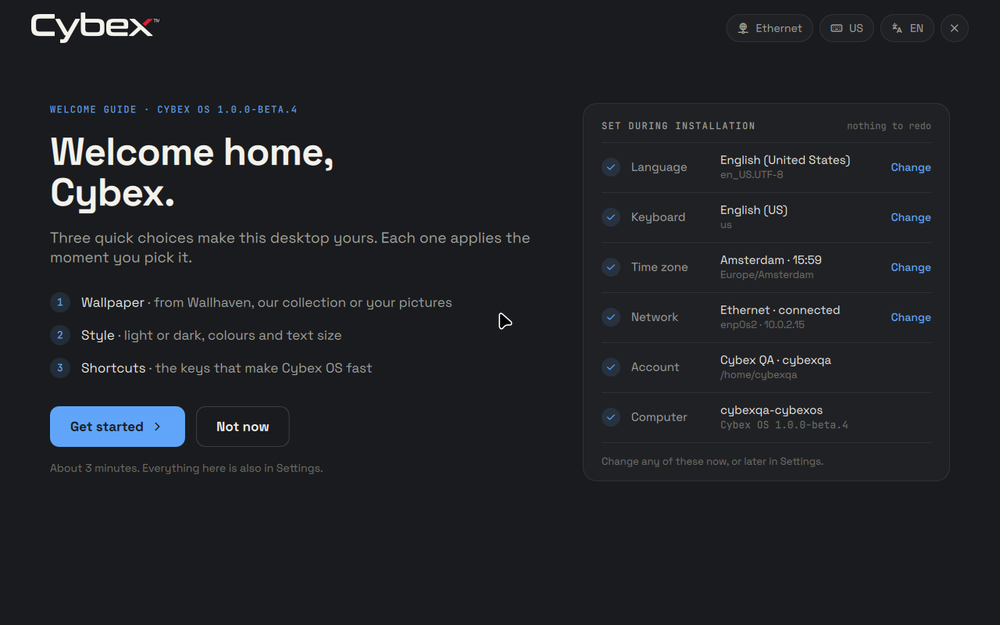
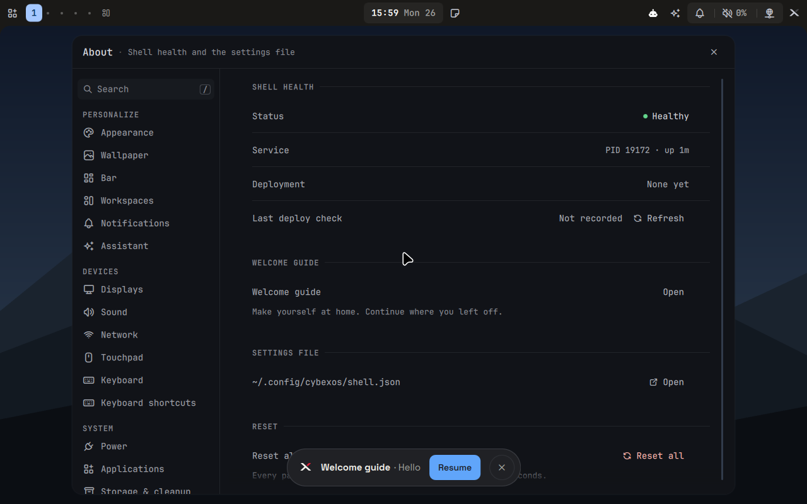

# Installer-style welcome guide on installed Hyprland — 2026-10-26

The welcome guide was redrawn in the installer's design: a full-screen
overlay layer with the installer's tokens, faces and 1280×800 canvas
(`docs/welcome.md`, contract §2.5). This round installed the `1.0.0-beta.4`
testing ISO and checked the guide in the real Hyprland 0.56 session of a
fresh installation, plain and encrypted. Both installations passed every
milestone and lifecycle check. The complete record is the
[JSON evidence](welcome-installer-style-2026-10-26.json). It follows the
[previous welcome guide record](welcome-onboarding-2026-10-25.md).

## Tested image

- Version `1.0.0-beta.4`, NixOS `26.05`, qualified commit
  `eec5d96bd7506665624113d6cd330f458bbc765d`. The source was clean and
  committed before building.
- Exact source NAR: `sha256-MW06aPuq27WfBYe3/HFn6i35Zwa8ABIeoev8+vOl7vw=`.
  The ISO's release record has this revision and NAR, and both
  installations matched it.
- ISO: `cybexos-1.0.0-beta.4-x86_64-linux.iso`, **7,120,576,512 bytes**,
  SHA-256 `1182d3112a4f5856975762dac8f562683ec49bf2e2a0dc829aa995b42d41d937`.
  Served as `/data/pxe/iso/cybexos-1.0.0-beta.4.iso`.

## What the qualification now checks

`welcomeFirstLogin` no longer looks for a window titled
`Welcome to Cybex OS`. It reads Hyprland's own layer list
(`hyprctl -j layers`) and requires, in order:

1. the guide's full-screen layer `qs-welcome` after first login, with the
   region and input services behind Hello loaded;
2. after `cybexos-runtime ipc settings open about`, a window over the guide:
   `status` reports `aside`, and only the resume pill `qs-welcome-resume`
   remains (Hyprland's `openwindow` event drove this, not a guide action);
3. after `welcome open ''`, the guide layer again and `aside` false;
4. after `welcome close`, a dismissed state and neither layer.

## Results

| Check | Result |
| --- | --- |
| `tests/run` | 626 Python and 1,443 Node tests passed, none failed |
| `tests/qml-lint` | 422 QML files and 4 harnesses, no qmllint errors |
| `tests/welcome-guide.py` (headless Sway) | Passed: zoom at four output sizes, stepping aside for the launcher, Wallhaven apply, Space peek, sheets, Dutch |
| `tests/shortcut-editor.py` (headless Sway) | Passed, including the guide's recorder and its shortcut inhibitor over the overlay layer |
| Real Hyprland `--verify-config` on the payload system | Passed |
| Plain installation, real tty1 installer, standard applications, lifecycle | Passed all 13 milestones and 8 lifecycle checks |
| Encrypted installation, same, automatic login after unlock | Passed all 13 milestones and 8 lifecycle checks |

On both installations the shell's journal had 10 lines and no QML errors,
including none from the guide's files. Hyprland reported 107 described binds
for 99 resolved actions, as before.

## Screenshots

- **Hello.** On the 1280 × 800 display the canvas is drawn at zoom 1.0 in
  Space Grotesk. It shows the account's full name, English (United States),
  English (US), Europe/Amsterdam, the Ethernet address, the account and the
  computer name, with the network, `US` and `EN` pills.
- **Stepping aside.** Settings opens over the desktop and the bar returns.
  The pill names the step the guide was on.

## Limits

- Only virtual OVMF/QEMU was exercised: virtio-vga at 1280 × 800, one
  monitor, the US layout. No physical hardware, other zooms on Hyprland, or
  other layouts.
- On Hyprland, the guide was opened on Hello, stepped aside for a window,
  resumed and dismissed. Wallpaper, Style, Shortcuts, Ready, the sheets and
  Space peek were driven only under headless Sway. So was the recorder's
  shortcut inhibitor over the overlay layer; Hyprland's handling of it is
  untested.
- The shortcut recorder is the shared Settings recorder, still drawn in the
  shell theme over the guide.
- This is a development source and ISO: no signed release, channel update
  or Secure Boot.

## Cleanup

The `agent-resource` lease `f2d985fb…` closed with nothing remaining. The
headless test work directories were private temporary directories, removed
at exit. The staging directories for the build, the qualification and the
headless screenshots were removed after the two screenshots above were
kept, including the ISO's result link: the served PXE copy is the delivered
image. The approved mockup moved into the repository as
`desktop/welcome-ui-reference/index.html`.
