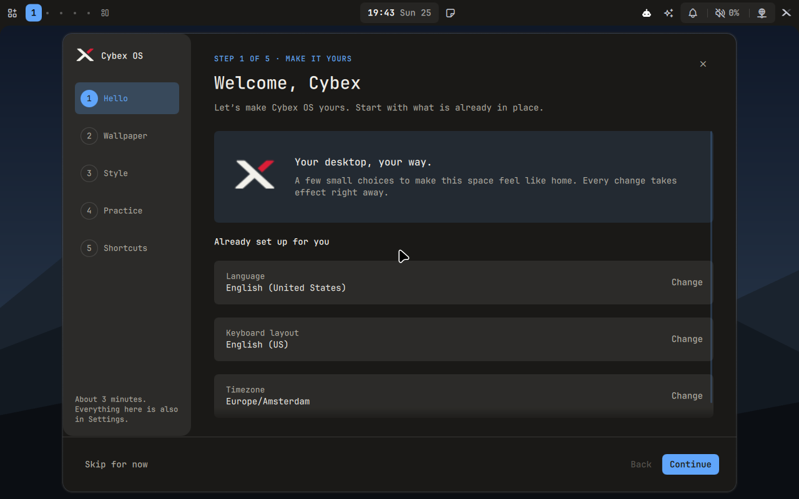
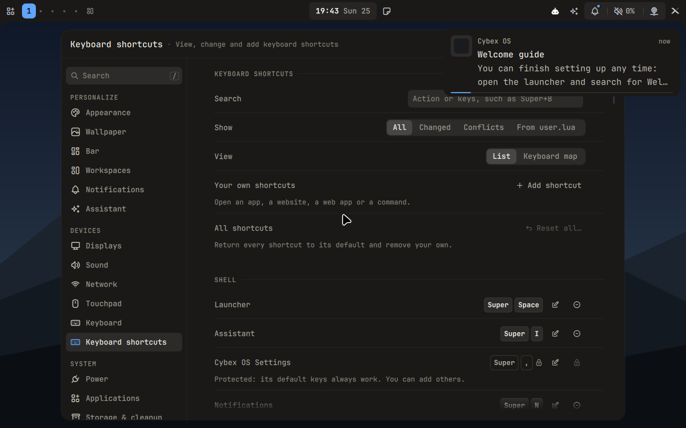
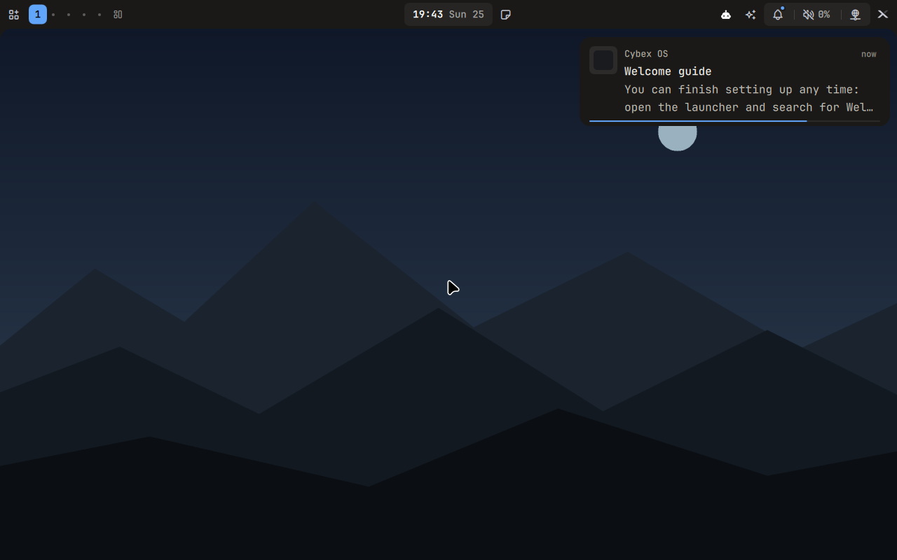

# Welcome guide and keyboard shortcuts on installed Hyprland — 2026-10-25

The welcome guide, the editable keyboard shortcuts and the Settings shortcuts
page had previously been tested only in the shell under headless Sway. This
round installed the testing ISO and checked them in the real Hyprland 0.56.2
session of a fresh installation. Testing found three defects that the Sway
tests could not show, plus one fault in the qualification script; all four
are fixed. The complete record is the
[JSON evidence](welcome-onboarding-2026-10-25.json). It follows the
[encrypted automatic login record](encrypted-autologin-2026-10-25.md).

## Tested image

- Version `1.0.0-beta.3`, NixOS `26.05`, qualified commit
  `576346731327aa4b083892891328e5e11a4e3802` on `feat/welcome-onboarding`.
  The source was clean and frozen before building.
- Exact source NAR: `sha256-iYPvhqbcknp3DAhXVG1Poba+XQRuBVguSaNj2517ywo=`.
  The ISO's release record has this revision and NAR. Both installations
  matched the NAR; their bundled path input reports revision `uncommitted`.
- ISO: `cybexos-1.0.0-beta.3-x86_64-linux.iso`, **7,120,576,512 bytes**,
  SHA-256 `3f6754157008ad748d3aa3b849d63963aa91094555faac8e30b0db15d6c226e4`.

## What the qualification now checks

`scripts/qualify-installations` gained the milestone
`keyboardShortcutsRuntime`. It runs as the session user on the installed
system:

- `hyprctl binds -j` parses as strict JSON. Every resolved key appears with
  its catalog description; mouse drags are exempt.
- `$XDG_RUNTIME_DIR/cybexos/keybindings-state.json` is version 1 and has no
  error. It binds the 40 action IDs that other streams rely on (contract
  §1.1), such as `shell.lock`, `apps.terminal` and `workspaces.move.1`.
  `hyprctl eval` confirms `__cybexos_keybindings_error` is nil.
- The shipped Settings service (`system-settings.py keybindings`) runs with
  the shell's own environment and PATH. Its snapshot carries an xkbcli keymap
  that maps keycode 10 to `1`.
- Through that service, `apps.browser` moves to `SUPER + ALT + B`, and a
  website shortcut, `SUPER + ALT + D` for `https://example.org`, is added.
  Hyprland then binds both, and the default `SUPER + B` is gone. The state
  file and a fresh snapshot agree. Reset all restores every default and
  leaves no custom entries. `user.lua` has the same hash before and after;
  it is absent on a fresh install.
- `cybexos-runtime ipc settings open shortcuts` opens Settings on
  **Keyboard shortcuts**, and the page is captured.
- The current Quickshell invocation's journal has no `TypeError`,
  `ReferenceError` or `Binding loop` from Welcome, Shortcut, Keybind or
  Wallpaper files.

`welcomeFirstLogin` additionally waits for the region and input services
behind the Hello step's summary, and fails the case if either does not load.
It also waits until Hyprland has unmapped the dismissed guide before
capturing the desktop. A failure in either milestone is recorded and fails the
case after the lifecycle has run, so its evidence is kept.

## Defects found and fixed

1. **Shortcut preferences never loaded on Hyprland** (`dd318fd`).
   Hyprland 0.56.2 embeds Lua 5.5, where a `for` loop variable is read-only.
   `keybinding_helpers.lua` assigned to one, so the module failed to compile.
   As a result:
   - the vendor defaults stayed bound;
   - no state file was written;
   - `__cybexos_keybindings_error` was set;
   - `cybexos-desktop-check` rejected the configuration, which would block
     every update stage.

   The dev shell ran Lua 5.4, which allows the assignment. It now provides
   Lua 5.5, and `tests/quickshell/hyprland-lua.test.cjs` checks the version
   and compiles every Hyprland and fixture Lua file.
2. **The state file was never published** (`d59de42`). Hyprland reaps child
   processes before Lua collects their status, so `os.execute("mkdir …")`
   returned `nil, "No child processes", ECHILD` even when it succeeded. The
   state writer now uses mktemp's printed path as the completion proof, as
   `workspace_state.lua` already does. A Lua test simulates the reaped status.
   A real Hyprland 0.56.2 `--verify-config` run on the `dd318fd` payload
   system found this before that ISO was qualified.
3. **Keyboard layouts unavailable on NixOS** (`5763467`, already on `main`).
   The Settings input catalog read `/usr/share/X11/xkb/rules/evdev.xml`,
   which NixOS does not have. As a result:
   - every input snapshot failed;
   - Settings → Keyboard had no data;
   - the guide's Hello step showed "Keyboard layout: Not available".

   The desktop wrapper now sets `XKB_CONFIG_ROOT`, only if unset, to the root
   libxkbcommon itself was built with, and the catalog reads it.
4. **Qualification script.** `installed-desktop.png` was captured before
   Hyprland redrew, so it still showed the dismissed guide.

## Checks exercised

| Check | Result |
| --- | --- |
| `tests/run` (Lua 5.5) | 626 Python and 1,461 Node tests; 1,445 passed, 16 skipped as before (no `luajit`/`fish` in the dev shell) |
| Guest shortcut driver against a fake session using the real Lua resolver | Passed before the first ISO |
| Real Hyprland 0.56.2 `--verify-config` (`desktop_check.verify_compositor`) on the payload system | Passed; state written, error nil |
| Plain installation, real tty1 installer, standard applications, lifecycle | Passed all 13 milestones and 8 lifecycle checks |
| Encrypted installation, same, automatic login after unlock | Passed all 13 milestones and 8 lifecycle checks |

The milestones are `isoSourceIdentity`, `nativeGuiAssertions`,
`installerCompleted`, `installedBootAndSerialPasswordLogin`, `quietBoot`,
`installedBootMenu`, `installedSourceIdentity`, `runtimeEncryption`,
`desktopConfigurationCheck`, `welcomeFirstLogin`, `keyboardShortcutsRuntime`,
`authenticatedDesktopHealth` and `sharedPasswordChanges`. The welcome guide
stayed dismissed after both password-change reboots.

On both installations Hyprland reported 107 described binds for 99 resolved
actions. The keymap had 478 entries for `us` (English (US)). The shell's
journal had 10 lines and no QML errors.

Earlier runs on this branch:

- `f8f3076` failed in both cases at `desktopConfigurationCheck` (defect 1).
- `d59de42` passed every milestone, but its screenshots showed defects 3
  and 4.

## Screenshots

- **Guide.** On real Hyprland it opens centred (about 1080 × 735 on the
  1280 × 800 display) with rounded corners and no foreign title bar. Text is
  upright and legible.
- **Hello step.** It shows English (United States), English (US) and
  Europe/Amsterdam.
- **Settings page.** It lists keycaps, with dimmed locks on protected rows.
- **Desktop.** After dismissal it shows the default moon-mountains wallpaper
  with the one-time “You can finish setting up any time” notification.
- **Notification icon.** The notification's icon is an empty square; most
  shell notifications send no `appIcon`.
- **Updates chip.** On the encrypted installation it shows a red count,
  because this development image deliberately has no available vendor
  channel.

## Limits

- Only virtual OVMF/QEMU was exercised: virtio-vga at 1280 × 800 and the US
  layout. No physical hardware, multiple monitors or other layouts were
  tested.
- The guide was opened, captured on its Hello step and dismissed. Its other
  steps, the wallpaper picker, Wallhaven and the practice tasks were not
  driven on Hyprland.
- Shortcut edits went through the Settings backend service, not through
  key presses recorded in the UI.
- This is a development source and ISO: no signed release, channel update
  or Secure Boot.

## Cleanup

All three `agent-resource` leases closed with nothing remaining:
`b1f9c2df…`, `56622891…` and `6b6784f8…`. The three superseded ISO builds
(`f8f3076`, `dd318fd`, `d59de42`) were deleted from the Nix store. The
qualified ISO, its checksum and the build's result link stay in the task
staging directory `/data/tmp/cxb3` for delivery. The other VM files, logs and
screenshots there were removed.
